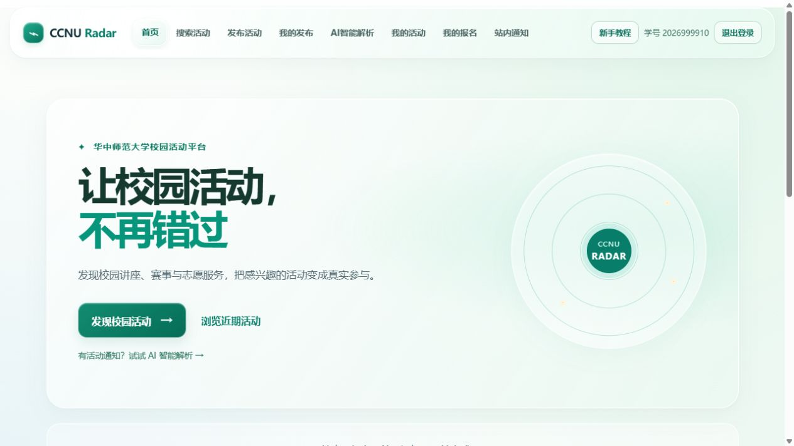

# CCNU Radar · 华中师范大学校园活动雷达

**让校园活动，不再错过。**

[](https://github.com/Ther0213/ccnu-radar/actions/workflows/ci.yml)
[项目仓库](https://github.com/Ther0213/ccnu-radar) · [演示验收清单](docs/ACCEPTANCE.md) · [后端详细说明](server/README.md)

CCNU Radar 是一个面向大学校园的活动发现与管理平台。它把散落在通知中的活动信息整理成清晰的活动卡片，让学生能够搜索、理解、报名和跟进活动，也让发布者能够管理活动信息、名额与报名名单。

本项目是可本地运行的黑客松全栈作品，使用 React + TypeScript + Vite 构建前端，Node.js + Express + SQLite 提供后端。**不配置 AI Key，也可以体验模拟解析以及完整的发布、报名和管理流程。**



## 目录

- [1. 项目背景与目标](#overview)
- [2. 产品特点与功能](#features)
- [3. 技术架构与目录](#architecture)
- [4. 从零安装与运行](#getting-started)
- [5. 完整使用示例](#examples)
- [6. AI 解析与配置](#ai)
- [7. 数据结构与接口示例](#api)
- [8. 临时公网分享](#sharing)
- [9. 测试与验收](#testing)
- [10. 数据保存与备份](#data)
- [11. 常见问题](#faq)
- [12. 当前边界与后续计划](#roadmap)

<a id="overview"></a>
## 1. 项目背景与目标

校园讲座、比赛、社团活动和志愿服务的通知往往分散在群聊、公告或推文中。学生需要逐条查找活动时间、报名截止、地点和参与条件；发布者也需要反复收集名单、统计名额和通知变更。

CCNU Radar 希望把这些步骤连接起来：

> 发现活动 → 理解通知 → 查看详情 → 报名参与 → 接收变更通知

| 使用者 | 可以完成的事情 |
| --- | --- |
| 学生 / 活动参与者 | 按兴趣搜索活动、解析通知、保存活动、报名或取消报名、查看 QQ 群号和站内通知 |
| 社团 / 活动组织者 | 发布活动、设置人数上限、维护活动信息、查看和导出报名名单、取消活动并说明原因 |
| 项目评审 / 开发者 | 从仓库独立安装运行，通过模拟解析和双账号流程完成演示与验证 |

这里的“发布者”是活动的创建者，同一个账号既可以参与活动，也可以发布自己的活动。当前没有学校认证的组织者或管理员角色；项目不代表学校官方服务。

<a id="features"></a>
## 2. 产品特点与功能

### 2.1 从通知理解到活动参与

- **结构化通知解析**：识别活动标题、类型、时间、截止时间、地点、对象与明确的人数上限。
- **摘要和建议**：根据已识别信息展示活动总结、通用参与建议和截止提示。
- **两种解析方式**：模拟解析可直接使用；真实解析可选接入 DeepSeek，界面明确区分来源。
- **缺失信息可见**：信息不足时使用“待确认”或合理提示，模拟解析不凭空补齐时间、地点和资格。
- **保存与报名分开**：通知可以先保存在“我的活动”，正式报名记录则保存在“我的报名”。

解析得到的本机记录不会自动成为公共活动。需要对外发布时，发布者仍须在发布表单中核对并填写信息。

### 2.2 完整的活动管理流程

| 模块 | 当前能力 |
| --- | --- |
| 首页 | 展示最多 8 个近期已发布活动；演示内容单独标识 |
| 搜索活动 | 关键词、类型、活动开始日期区间、剩余名额和人数上限状态筛选 |
| 活动详情 | 时间、地点、对象、摘要、截止提示、报名状态和 QQ 群号 |
| 报名 | 登录后报名；重复报名不重复占位；取消报名释放名额 |
| 名额统计 | 后端事务中检查和写入报名，防止并发超额 |
| 我的发布 | 编辑活动、查看名单、导出 CSV、取消活动并填写原因 |
| 变更通知 | 编辑和取消活动时通知已报名同学 |
| 截止提醒 | 已报名活动的可识别截止时间进入 24 小时窗口时，查询通知可生成一次提醒 |
| 我的活动 | 在当前浏览器保存活动；已发布活动的信息可定期同步 |
| 我的报名 | 查看当前账号的后端报名记录，包括已取消活动的状态 |
| QQ 群 | 发布或编辑时选填 5–12 位数字群号，详情中支持复制 |

活动状态包括“报名中、已满员、已截止、已取消”；无法确定截止或名额时显示待确认。取消状态优先于截止，截止优先于满员。日期按北京时间解释，建议发布时填写完整年份。

### 2.3 易用性与可信呈现

- 中文界面、绿色玻璃风格、响应式布局。
- 新注册账号有分步教程，完成状态随账号保存。
- 页面使用哈希路由，支持刷新、浏览器前进和后退，切换页面回到顶部。
- 演示活动、未发布的解析记录和已发布活动有不同标识，避免误认为都可报名。
- 收藏失败、后端未启动、AI 未配置、名额已满等情况有明确提示。

### 2.4 实现中的安全措施

- 学号＋独立密码登录，密码使用随机盐和 scrypt 哈希保存。
- 会话使用 HttpOnly、SameSite Cookie；HTTPS 分享入口使用 Secure Cookie。
- 编辑、取消、查看名单和导出名单均检查活动归属。
- 限制 JSON 请求体大小，校验写入请求来源，限制登录尝试和真实 AI 调用。
- CSV 导出处理公式注入；真实 AI 的返回字段采用白名单。
- API Key 仅由后端使用；仓库排除本机配置、数据库、隧道令牌和依赖目录。

这些措施适用于当前演示规模，并不等于已经完成正式上线所需的全部安全审计。

<a id="architecture"></a>
## 3. 技术架构与目录

| 层次 | 技术 | 用途 |
| --- | --- | --- |
| 前端 | React 19、TypeScript、Vite | 页面、组件、状态和开发热更新 |
| 样式 | CSS | 绿色主题、玻璃效果和响应式布局 |
| 后端 | Node.js 24、Express 5 | 账号、活动、报名、通知和解析接口 |
| 数据库 | Node.js 内置 SQLite | 持久保存账号、会话、活动、报名与通知 |
| 本机存储 | localStorage | 当前浏览器的活动收藏 |
| AI | 本地规则模拟解析 / 可选 DeepSeek | 活动通知结构化与总结 |
| 质量检查 | ESLint、TypeScript、node:test、GitHub Actions | 代码检查、测试与构建 |

```text
浏览器中的 React 页面
  ├─ 模拟解析 → 本地生成 Event
  ├─ 我的活动 → localStorage
  └─ /api 请求 → Express
                    ├─ SQLite：账号、活动、报名、通知
                    └─ DeepSeek：可选的真实通知解析
```

开发模式由 Vite 将 `/api` 转发到后端；单窗口运行模式由 Express 同时提供构建后的页面和 API，浏览器无需跨域请求。

```text
ccnu-radar/
├─ README.md
├─ package.json                  # 根目录安装、运行与检查命令
├─ start-local.cmd               # Windows 一键构建和启动
├─ vite.config.ts                # 开发端口与 /api 代理
├─ .github/workflows/ci.yml       # GitHub 自动检查
├─ public/                       # 公共静态资源
├─ src/
│  ├─ components/                # 导航、卡片、详情、表单、教程
│  ├─ pages/                     # 首页、搜索、解析、登录、发布等
│  ├─ services/                  # API 客户端、模拟解析、收藏存储
│  ├─ types/                     # Event 等 TypeScript 类型
│  ├─ utils/                     # 日期、筛选、状态、路由工具
│  └─ styles/                    # 全站玻璃样式
├─ server/
│  ├─ index.js                   # API 服务入口
│  ├─ serve.js                   # 网页＋API 单窗口入口
│  ├─ auth.js                    # 密码和会话
│  ├─ events.js                  # 活动存储
│  ├─ registrations.js           # 报名与名额
│  ├─ activity-management.js     # 名单、编辑、取消、通知
│  ├─ deepseek.js                # 真实 AI 调用与结果校验
│  ├─ .env.example               # 可提交的配置示例
│  ├─ *.test.js                  # 独立自动测试
│  ├─ data/                      # 运行时创建，不提交 Git
│  └─ start-share.cmd            # Windows ngrok 分享入口
└─ docs/
   ├─ ACCEPTANCE.md              # 演示与验收清单
   └─ images/home.jpg            # 产品预览图
```

<a id="getting-started"></a>
## 4. 从零安装与运行

### 4.1 环境要求

- **Node.js 24**，安装后自带 npm。可从 [Node.js 官网](https://nodejs.org/) 获取。
- 使用 Git 克隆时需要 Git；也可通过仓库的 **Code → Download ZIP** 下载并解压。
- 首次安装依赖需要联网。
- 推荐使用较新的 Edge、Chrome 或 Firefox。

验证环境：

```sh
node --version
npm --version
git --version
```

Node 输出应以 `v24.` 开头；ZIP 下载方式不需要执行最后一条命令。Windows 和 GitHub 的 Ubuntu 检查环境已验证；macOS 可采用同一套 npm 命令，但不运行 Windows 的 `.cmd` 文件。

### 4.2 获取代码

```sh
git clone https://github.com/Ther0213/ccnu-radar.git
cd ccnu-radar
```

若使用 ZIP，解压后打开包含根目录 `package.json` 和 `src/` 的文件夹，在该文件夹打开终端。下面的命令除特别说明外，**都在项目根目录执行**。

### 4.3 推荐：单窗口运行完整产品

```sh
npm run setup
npm run build
npm start
```

这些命令依次完成：

1. 按锁文件安装前端和 `server/` 中的后端依赖。
2. 检查前端类型，构建页面到 `dist/`。
3. 用一个 Node 进程提供完整网页和后端 API。

看到以下提示后，在浏览器打开 **http://localhost:3001**：

```text
CCNU Radar ready: http://localhost:3001
Website and API are running together. Keep this process running; Ctrl+C stops it.
```

首次运行没有预置账号和真实活动。请在页面注册账号，然后发布自己的测试活动。页面中的演示活动只用于体验，不能真实报名。

**没有 DeepSeek Key 可以直接开始使用**：通知解析选择“使用模拟解析（不发送通知）”，其他发布和报名功能照常运行。

Windows 用户也可以双击根目录 `start-local.cmd`。脚本会检查依赖、构建并启动；需先安装 Node.js 24。依赖版本发生更新后，应先重新执行 `npm run setup`。

### 4.4 停止、再次启动与更新

- 停止：在运行服务的终端按 **Ctrl+C**。
- 再次启动：在根目录运行 `npm start`，或双击 `start-local.cmd`。
- 修改前端后：重新执行 `npm run build`，刷新网页。
- 修改后端或 `server/.env` 后：停止旧服务，再运行 `npm start`。
- 拉取新版本：先妥善保存自己的代码改动，在停止服务后执行：

```sh
git pull --ff-only
npm run setup
npm run build
npm start
```

这些步骤不要求删除 `server/data/`。如果 Git 提示本地改动冲突，先保留并处理改动，不要直接覆盖。

### 4.5 开发模式：前后端分别运行

需要编辑前端后即时刷新时，使用两个终端。

**终端 A：后端**

```sh
npm run dev:server
```

**终端 B：前端**

```sh
npm run dev
```

然后打开 **http://localhost:5173**。

| 模式 / 服务 | 入口 | 说明 |
| --- | --- | --- |
| 单窗口产品模式 | http://localhost:3001 | `npm start`，网页和 API 同时运行 |
| 开发前端 | http://localhost:5173 | `npm run dev`，支持热更新 |
| 开发后端 | http://localhost:3001/api/health | `npm run dev:server`，主要提供 API |
| 临时分享后端 | 本机 3002 | 由分享脚本启动，外部使用输出的 HTTPS 地址 |

单窗口模式和开发后端都占用 3001，**不要重复启动两份**。已有单窗口服务时，可以额外运行 Vite，用它提供的 5173 开发页面访问同一后端。

根目录与 `server/` 下的 `npm start` 含义不同：根目录启动完整网页，`server/` 下只启动 API。初次使用推荐一直在根目录操作。

### 4.6 验证后端

浏览器访问 **http://localhost:3001/api/health**，应看到：

```json
{
  "status": "ok",
  "message": "CCNU Radar backend running"
}
```

PowerShell 也可以运行：

```powershell
Invoke-RestMethod http://localhost:3001/api/health
```

这表示后端可以访问；网页首页地址是 `http://localhost:3001/`。

<a id="examples"></a>
## 5. 完整使用示例

### 5.1 示例一：通知解析、智能总结与收藏

进入“AI智能解析”，复制下面的虚构通知：

```text
活动名称：桂子山环保志愿服务
活动类型：志愿服务
活动时间：2099-11-10 08:30
报名截止：2099-11-08 18:00
活动地点：桂子山校区
参与对象：全校学生
人数上限：30人
活动说明：开展校园环境维护，请准时到场。
```

点击 **“使用模拟解析（不发送通知）”**，可得到以下结构。示例使用远期日期，避免演示时已经截止；实际发布时请换成真实日期。`id` 在运行时生成。

```json
{
  "id": "parsed-<运行时生成>",
  "title": "桂子山环保志愿服务",
  "type": "志愿服务",
  "time": "2099-11-10 08:30",
  "deadline": "2099-11-08 18:00",
  "location": "桂子山校区",
  "audience": "全校学生",
  "description": "活动名称：桂子山环保志愿服务\n活动类型：志愿服务\n活动时间：2099-11-10 08:30\n报名截止：2099-11-08 18:00\n活动地点：桂子山校区\n参与对象：全校学生\n人数上限：30人\n活动说明：开展校园环境维护，请准时到场。",
  "summary": "“桂子山环保志愿服务”为志愿服务活动，面向全校学生开放。",
  "recommendation": "适合希望积累实践经历、参与校园公益的同学。",
  "urgency": "请注意报名截止时间：2099-11-08 18:00",
  "maxParticipants": 30
}
```

页面会展示基础信息及“活动智能总结、参与建议、报名截止提醒”三个区域。点击“收藏活动”或“加入我的活动”，再进入“我的活动”，刷新后记录仍在当前浏览器中。

该记录标为“未发布”，不会自动提供真实报名。删除本机收藏不会取消后端报名；清除浏览器站点数据会清除本机收藏。

### 5.2 示例二：不同格式与缺失信息

**比赛通知：标题用括号、字段使用不同分隔符**

```text
【校园程序设计竞赛】
举办时间 - 2099-11-12 09:00；举办地点：九号教学楼；
报名截止时间：2099-11-10 23:59。
面向对象：本科生。
限额：50人
```

模拟解析应识别标题“校园程序设计竞赛”、类型“赛事”、举办时间、地点、报名截止、对象和 50 人上限。

**信息不足的通知**

```text
活动名称：校园交流活动
```

模拟解析会保留已知活动名称，时间、截止、地点和对象显示“待确认”，人数上限为 `null`，截止提醒为“暂无截止提醒”。

页面还提供“创新创业比赛、校园讲座、志愿活动”三个示例按钮。按钮中的日期只用于解析演示，并不保证当时仍可报名。

### 5.3 示例三：两个账号完成真实报名与发布管理

使用普通窗口作为发布者 A，另一个浏览器或无痕窗口作为参与者 B，避免共享同一个登录会话。

**第一步：注册与发布**

1. 在两个窗口分别注册账号。学号格式为 6–20 位数字，密码为 8–128 个字符。
2. 本地演示可分别使用虚构学号 `20990001` 和 `20990002`；密码自行设置，仓库没有预置账号。
3. A 完成或跳过教程，进入“发布活动”，填写：

| 字段 | 演示填写内容 |
| --- | --- |
| 活动名称 | 校园编程交流会 |
| 活动类型 | 校园活动 |
| 活动时间 | 2099-11-12 19:00 |
| 报名截止时间 | 2099-11-11 18:00 |
| 活动地点 | 九号教学楼测试教室 |
| 参与对象 | 全校学生 |
| 人数上限 | 1 |
| 活动 QQ 群号 | 留空，或填组织者实际管理的群号 |
| 活动说明 | 本地演示用的虚构编程交流活动。 |

发布成功后，活动出现在公共搜索中，也会在符合近期展示规则时出现在首页。

**第二步：报名与名额**

1. B 搜索“校园编程交流会”，打开“查看详情”。
2. 点击“立即报名”，应看到报名成功、已报 1 人、剩余 0 个名额。
3. 在“我的报名”中可以找到该活动。刷新后报名记录仍保留。
4. B 取消报名，剩余名额恢复为 1；再报名不会产生重复记录。
5. 若要测试满员限制，可另注册一个测试账号 C，在 B 已占位时尝试报名。

**第三步：发布者管理与通知**

1. A 进入“我的发布”，查看报名名单或导出 CSV；B 无权查看其他参与者名单。
2. A 修改活动地点或 QQ 群号并保存，B 在“站内通知”中看到变更。通知通常在进入页面或下一次定期刷新时出现。
3. 已有 1 人报名时，A 不能把上限改成小于已报名人数的值。
4. A 填写“场地临时维修”等原因并取消活动。活动停止接受报名，公共列表隐藏；B 的报名记录保留取消原因。
5. 已取消活动不能继续编辑。取消报名和取消整个活动是两种不同操作。

如果填写 QQ 群号，参与者可在详情点击“复制群号”，随后到 QQ 搜索。是否可以入群由群设置决定，入群不等于网站报名。

<a id="ai"></a>
## 6. AI 解析与配置

### 6.1 两种方式的区别

| 项目 | 模拟解析 | 真实 DeepSeek 解析 |
| --- | --- | --- |
| 是否需要 API Key | 不需要 | 需要后端配置 |
| 是否需要登录 | 不需要 | 需要 |
| 通知是否发送给外部服务 | 不发送 | 发送给 DeepSeek |
| 处理方式 | 标签、关键词、正则和摘要模板 | 模型提取，后端校验返回字段 |
| 适用场景 | 离线规则演示、无 Key 验收、服务不可用时备用 | 更灵活的自然语言通知 |
| 页面标识 | 模拟 AI 解析 | DeepSeek AI 解析 |

模拟解析在浏览器中运行，但完整网站的账号、发布、报名等仍需要本地后端。建议模拟通知按行提供“活动时间、报名截止、地点、参与对象”等字段。不要将规则解析描述为真实大模型调用。

### 6.2 配置步骤

1. 在自己的 DeepSeek 平台账号中获取 API Key，并确认账号可调用的模型和额度。
2. 将 `server/.env.example` 复制为 `server/.env`。已存在配置文件时直接编辑，不要覆盖原 Key。
3. 只在本机填写配置，停止并重新启动后端。
4. 登录网站，在解析页输入通知，点击“开始解析活动通知”。

首次创建配置文件的 PowerShell 命令：

```powershell
if (-not (Test-Path server/.env)) {
  Copy-Item server/.env.example server/.env
}
notepad server/.env
```

macOS / Linux：

```sh
test -f server/.env || cp server/.env.example server/.env
# 使用自己的文本编辑器打开 server/.env
```

配置字段：

| 变量 | 用途 | 当前仓库默认值 |
| --- | --- | --- |
| `DEEPSEEK_API_KEY` | 后端调用密钥 | 空；未配置时真实解析不可用 |
| `DEEPSEEK_MODEL` | 模型标识 | `deepseek-flash`；请按账号实际可用模型调整 |
| `PORT` | 本地服务端口 | `3001` |

```dotenv
DEEPSEEK_API_KEY=在本机填入自己的Key
PORT=3001
DEEPSEEK_MODEL=deepseek-flash
```

模型默认值反映仓库配置，不保证外部平台始终提供该模型。真实调用依赖外部网络、余额和模型权限；自动测试不调用付费服务。

通知最大 5000 字，后端上游超时为 45 秒。当前演示额度为每账号每小时最多 5 次、每服务进程每 24 小时最多 30 次、最多 2 个并发；计数在进程重启后重置。超时或调用失败时，可以改用模拟解析。

QQ 群号目前通过发布 / 编辑表单填写，解析器不承诺自动提取群号。不要把通知中的未核实号码当成已验证联系方式。

<a id="api"></a>
## 7. 数据结构与接口示例

### 7.1 Event 数据结构

类型定义位于 [src/types/event.ts](src/types/event.ts)。

| 字段 | 类型 | 说明 |
| --- | --- | --- |
| `id` | string | 活动唯一标识 |
| `title` | string | 活动名称 |
| `type` | EventType | 赛事、讲座、志愿服务、社团活动、校园活动或待确认 |
| `time` | string | 活动时间 |
| `deadline` | string | 报名截止时间 |
| `location` | string | 活动地点 |
| `audience` | string | 参与对象 |
| `description` | string | 通知原文或活动说明 |
| `summary` | string | 活动摘要 |
| `recommendation` | string | 参与建议 |
| `urgency` | string | 截止提醒 |
| `maxParticipants` | number 或 null | 人数上限；未设上限时后端不限制名额 |
| `registeredCount` | number，可选 | 后端统计的已报名人数 |
| `qqGroup` | string，可选 | 活动 QQ 群号 |
| `withdrawn` | boolean，可选 | 是否取消 / 撤回 |
| `cancellationReason` | string，可选 | 取消原因 |
| `source` | published / demo / local，可选 | 前端活动来源标识，不用于授权 |

活动发布由后端生成 ID 与摘要等字段；不要通过传入 `source`、报名人数或活动 ID 绕过服务端逻辑。

### 7.2 主要接口

默认基址为 `http://localhost:3001`。登录通过 Cookie 会话，不需要在前端保存密码或 API Key。

| 方法 | 路径 | 用途 / 权限 |
| --- | --- | --- |
| GET | `/api/health` | 健康检查 |
| POST | `/api/auth/register`、`/api/auth/login` | 注册、登录 |
| GET | `/api/auth/me` | 当前会话账号 |
| POST | `/api/auth/logout` | 退出并撤销会话 |
| POST | `/api/auth/onboarding` | 保存当前账号教程完成状态 |
| GET | `/api/events` | 公共活动列表 |
| POST | `/api/events` | 发布活动，需要登录 |
| GET | `/api/my-publications` | 当前账号的发布 |
| PUT | `/api/events/:id` | 编辑自己的活动 |
| POST | `/api/events/:id/cancel` | 取消自己的活动，提交 reason |
| GET | `/api/events/:id/registration` | 实时名额与当前用户报名状态 |
| POST / DELETE | `/api/events/:id/registration` | 报名 / 取消报名，需要登录 |
| GET | `/api/registrations` | 当前账号的报名 |
| GET | `/api/events/:id/participants` | 仅发布者可读取的名单 |
| GET | `/api/events/:id/participants?format=csv` | 仅发布者可导出 CSV |
| GET | `/api/notifications` | 当前账号的通知 |
| POST | `/api/notifications/:id/read` | 标记自己的通知已读 |
| POST | `/api/notifications/read-all` | 当前账号全部通知已读 |
| POST | `/api/events/saved` | 按 ids 查询公共活动最新信息 |
| POST | `/api/parse` | 真实 AI 解析，需要登录与后端 Key |

JSON 请求体上限为 16 KB。常见响应包括 400（参数不正确）、401（未登录）、403（来源不允许）、404（资源不存在或无管理权限）、409（状态或名额冲突）、429（限流）、503（AI 未配置）。具体判断以响应中的 message 为准。

### 7.3 PowerShell：注册测试账号并发布活动

仅在自己的本地验收环境执行，以下脚本会实际创建一个虚构账号和活动。若该学号已注册，使用自己的测试密码，将第一条请求路径从 `register` 改为 `login`。

```powershell
$base = "http://localhost:3001"
$credentials = @{
  studentId = "20990003"
  password = "LocalDemoOnly!123"
} | ConvertTo-Json

Invoke-RestMethod -Uri "$base/api/auth/register" -Method Post `
  -ContentType "application/json; charset=utf-8" `
  -Body ([Text.Encoding]::UTF8.GetBytes($credentials)) -SessionVariable radarSession

$activity = @{
  title = "接口演示活动"
  type = "校园活动"
  time = "2099-11-12 19:00"
  deadline = "2099-11-11 18:00"
  location = "测试教室"
  audience = "测试同学"
  description = "仅用于本地接口演示。"
  maxParticipants = 10
  qqGroup = ""
} | ConvertTo-Json

$published = Invoke-RestMethod -Uri "$base/api/events" -Method Post `
  -ContentType "application/json; charset=utf-8" `
  -Body ([Text.Encoding]::UTF8.GetBytes($activity)) -WebSession $radarSession

$published.event
Invoke-RestMethod -Uri "$base/api/events"
```

示例密码仅用于一次性本地测试，不能用于真实账号。命令返回的 `event.id` 可用于接口表中的 `:id`。网页是推荐的日常操作入口。

<a id="sharing"></a>
## 8. 临时公网分享

`localhost` 指向访问者自己的电脑，直接发给同学无法访问你的服务。项目提供 ngrok 临时分享脚本，由独立服务在 3002 提供页面和 API。

### Windows 首次配置

1. 从 [ngrok 官方网站](https://ngrok.com/) 获取 Windows 客户端，解压后将 `ngrok.exe` 放到 `server/tools/ngrok.exe`。
2. 登录自己的 ngrok 账号，在控制台取得 Authtoken。
3. 已完成 `npm run setup` 后，双击 `server/start-share.cmd`。
4. 首次提示时粘贴 **Authtoken 本身**并回车。输入不会显示；它不是 DeepSeek Key，也不是整条 ngrok 命令。
5. 等待构建和连接完成，出现 `SHARE_URL=https://...` 后再分享该网址。

已配置令牌后，可在根目录手动运行：

```sh
npm run build
npm --prefix server run share:ngrok
```

- `server/.ngrok.local.yml` 保存本机令牌；`server/tools/`、令牌文件和分享状态文件都不提交到 GitHub。
- 分享入口与本地后端共用数据库。重启分享会加载新的后端代码，构建后的页面也会更新。
- 需保持电脑联网、不休眠、分享进程运行；Ctrl+C 停止分享。
- 链接是否可访问取决于访问者网络，不能保证所有校园或运营商网络均可访问。
- 当前 ngrok 启动脚本指定 Windows 可执行文件；macOS / Linux 公网部署需另行配置。
- 临时通道不是长期部署。正式上线需另行准备 HTTPS、持久化磁盘、进程管理和备份。

**GitHub 仓库提供源码，不会自动运行 Express 和 SQLite。GitHub Pages 只托管静态内容，不能单独运行本项目完整后端。** 提交仓库链接和提交在线演示链接是两件不同的事情。

<a id="testing"></a>
## 9. 测试与验收

在项目根目录运行：

```sh
npm run check
```

该命令依次执行代码检查、自动测试、类型检查与构建。也可分别运行：

| 命令 | 作用 |
| --- | --- |
| `npm run lint` | ESLint 检查前端 TypeScript / React |
| `npm test` | 后端及业务工具自动测试 |
| `npm run build` | TypeScript 检查和 Vite 构建 |
| `npm run check` | 上述三项的完整检查 |

当前交付版包含 **28 项自动测试**，覆盖账号与会话、权限隔离、报名并发和重复报名、名额释放、编辑取消、名单导出、通知、QQ 群号、教程、日期与活动状态、保存信息同步，以及单窗口入口和分享模式。

测试使用独立内存或临时数据库，不修改 `server/data/` 中的真实记录，不发送真实 DeepSeek 请求。代码推送后，[GitHub Actions](https://github.com/Ther0213/ccnu-radar/actions) 使用 Node.js 24 在 Ubuntu 环境执行相同检查。

人工验收建议按第 5 节双账号流程演示，另见 [验收清单](docs/ACCEPTANCE.md)。自动测试通过不代表已经验证所有网络环境或外部 AI 供应商的实时可用性。

<a id="data"></a>
## 10. 数据保存与备份

| 数据 | 存储位置 | 刷新 / 重启后 |
| --- | --- | --- |
| 账号、会话 | `server/data/` 中的 SQLite | 持久保留；会话仍受有效期限制 |
| 活动、报名、通知 | `server/data/` 中的 SQLite | 持久保留 |
| 我的活动 / 收藏 | 当前浏览器的 localStorage | 普通刷新保留；清除站点数据后丢失 |
| DeepSeek Key | 本机 `server/.env` | 重启后读取，不能提交 |
| ngrok Authtoken | 本机 `server/.ngrok.local.yml` | 分享服务启动时使用，不能提交 |

首次运行会在需要时自动创建数据库。仓库不包含预置的真实用户和活动数据。

备份前，先停止所有使用同一数据库的后端和分享进程，再将整个 `server/data/` 文件夹复制到私有备份位置。恢复时也应先停止服务，保留当前副本后再替换，避免丢失已有数据。

浏览器的收藏按站点来源区分，例如 `localhost:5173`、`localhost:3001` 和 ngrok 域名是不同来源。切换入口后收藏可能不同，登录状态也可能需要重新建立；后端账号和报名在共用同一数据库时仍是同一份数据。收藏目前不按账号跨设备同步。

<a id="faq"></a>
## 11. 常见问题

| 现象 | 处理方法 |
| --- | --- |
| `node` 或 `npm` 不是可识别命令 | 安装 Node.js 24，重新打开终端，再检查版本 |
| PowerShell 提示禁止运行 npm.ps1 | 在同一命令中使用 `npm.cmd`，例如 `npm.cmd run setup`；不必为此关闭系统安全策略 |
| `Missing script: dev` | 通常在 `server/` 执行了前端命令；回到项目根目录执行 |
| 3001 或 5173 已被占用 | 已有服务在运行；先尝试打开对应页面，或在原服务窗口 Ctrl+C 后再启动 |
| 单窗口启动提示需要先 build | 在根目录运行 `npm run build`，再运行 `npm start` |
| 浏览器只看到健康检查 JSON | 访问的是 `/api/health`；首页是 `http://localhost:3001/` |
| `server/` 下启动后访问首页返回接口不存在 | 该入口只启动 API；使用根目录 `npm start`，或启动 Vite 后访问 5173 |
| 页面提示无法连接后端 | 单窗口模式重新运行 `npm start`；开发模式检查终端 A 的后端是否启动 |
| 提示未配置 DeepSeek Key | 在 `server/.env` 配置并重启后端，或者使用模拟解析 |
| 真实 AI 调用失败或额度用尽 | 检查外部账号、模型与网络；限流时等待后重试；模拟解析可作为备用 |
| 新功能报 `API endpoint not found` | 停止旧后端并启动新代码；公网使用时也要重启分享进程 |
| 演示活动无法报名 | 演示卡片只用于体验；注册并发布一条未来日期的活动后测试报名 |
| 活动已满员或已截止 | 查看实时名额与截止时间；演示时换成未来日期，不要改数据库绕过规则 |
| 收藏后换入口看不到记录 | 收藏属于原浏览器和原站点来源；与后端“我的报名”不同 |
| 看不到别人的报名名单 | 名单仅活动发布者可以查看，普通参与者没有此权限 |
| 站内通知没有立即出现 | 进入通知页或等待下一次刷新；它不是短信或浏览器离线推送 |
| Node 显示 SQLite ExperimentalWarning | 当前 Node 内置 SQLite 的提示；以启动成功和健康接口响应判断服务是否正常 |
| ngrok 提示 ERR_NGROK_105 | 核对本机 Authtoken；可在 server 目录运行 `node configure-ngrok.js` 重新配置 |
| 隧道超时或同学打不开公网链接 | 检查分享进程、网络与 VPN 路由；只在输出 SHARE_URL 后分享；不保证所有网络可达 |
| 提示本地启动器不支持 production | 本地模式不要设置 `NODE_ENV=production`；公网 HTTPS 使用独立分享入口或另行部署 |

不要为解决启动问题删除数据库、提交 API Key，或把旧的运行窗口误认为已加载最新后端。

<a id="roadmap"></a>
## 12. 当前边界与后续计划

### 当前已知边界

- 学号由用户自行填写，尚未接入学校身份核验；请使用独立密码。
- 尚未实现密码找回、内容审核、管理后台或组织者认证。
- 个人收藏属于当前浏览器，不随账号跨设备同步。
- 截止提醒在查询通知时触发；整个提醒窗口过去后不会补发，且没有短信、邮件或离线推送。
- 模拟解析适合有清晰标签的通知，不保证理解所有自由文本；真实 AI 结果也需要用户核对。
- QQ 群号由发布者维护，系统不核验群身份。
- 当前设计面向单机演示，尚未验证大规模负载和长期生产运维。

### 后续可扩展方向

以下为规划，**不计入当前已实现功能**：

1. 学校统一身份认证或组织者审核。
2. 收藏云同步、账号恢复和个人资料管理。
3. 活动内容审核、举报处理和管理后台。
4. 日历导出、个性化订阅与更完善的提醒渠道。
5. 稳定公网部署、自动备份和运行监控。

---

如果希望快速了解产品，先阅读第 2 节特点，按第 4 节启动，再使用第 5 节示例走完“解析、发布、报名、管理、通知”的完整流程。
